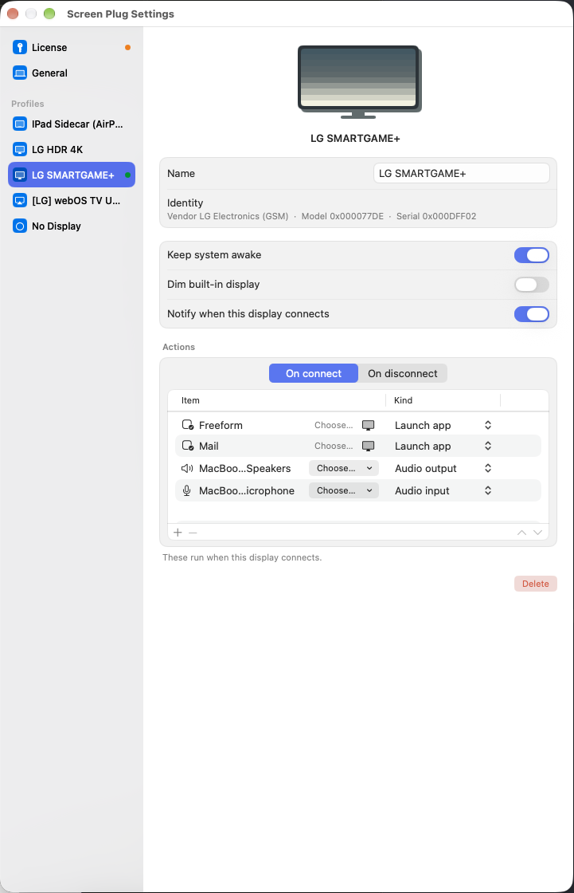
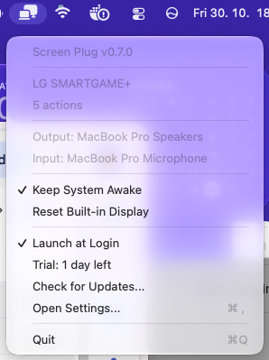
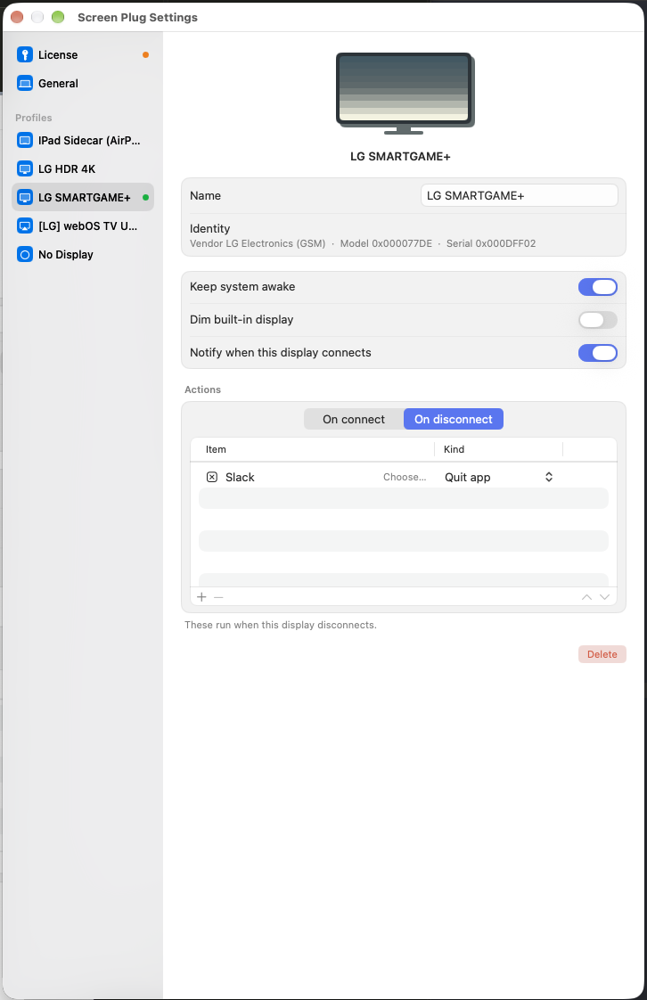
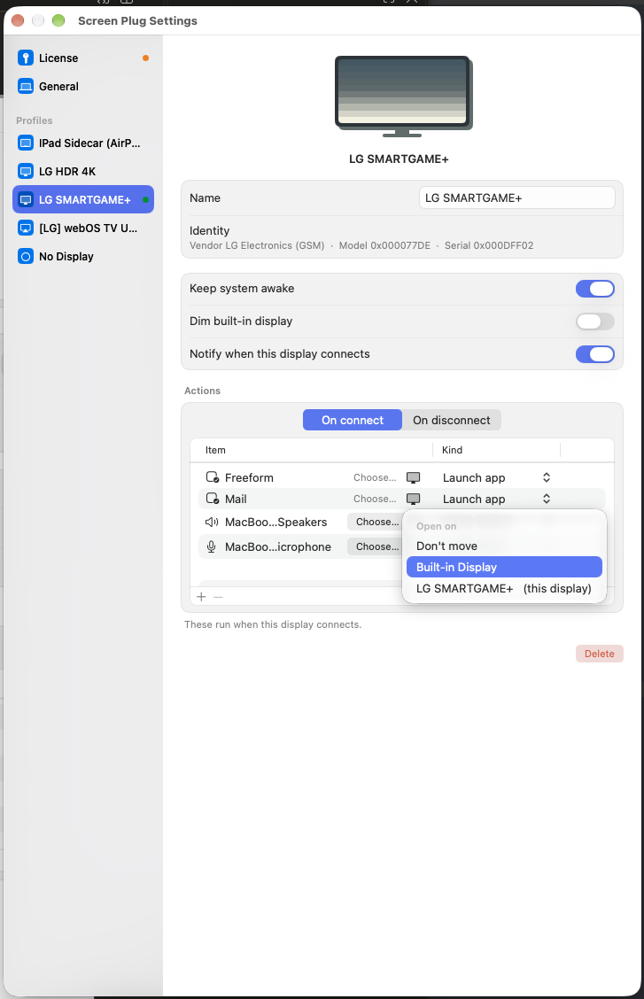
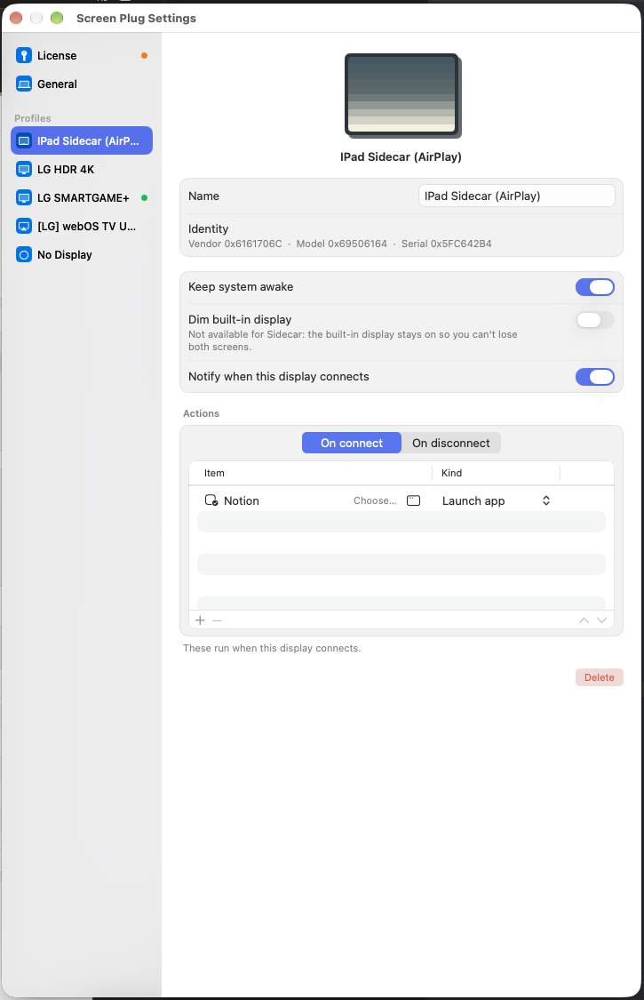
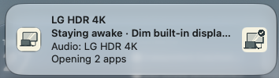
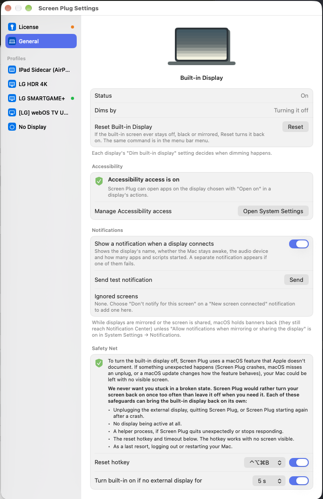

# 🔌 Screen Plug

**Plug in a monitor. Your Mac sets itself up.**

A macOS menu bar app that applies the right settings and actions every time a display connects or disconnects.

 

 

## ✨ Why Screen Plug

Docking your laptop usually means the same chores: keep the Mac awake, open your apps, switch the audio, turn off the built-in screen. Screen Plug does them for you, per display, and undoes them when you unplug.

| | |
|---|---|
| 🖥️ **Per-display profiles** | Each monitor is recognized by its EDID vendor, model and serial number and keeps its own settings. |
| ☕ **Keep awake** | Hold the Mac awake only while a chosen display is connected. |
| 🌙 **Dim built-in display** | Turn the laptop screen off while an external one is in use, and back on when you unplug. |
| ⚡ **Connect & disconnect actions** | Launch or quit apps, run Shortcuts, run shell commands, switch audio output or input. |
| 🪟 **Open apps on a chosen display** | Pick which screen a launched app opens on (needs Accessibility access). |
| 🔀 **Multiple displays** | Every connected screen gets its profile, and actions run for a screen even when another one is the active display. |
| 🔔 **Connect notifications** | See at a glance what was applied and whether anything failed. |
| 🛟 **Safety net** | Several independent paths bring the built-in display back, so you never get stuck with a black screen. |
| 📱 **Sidecar & AirPlay aware** | An iPad used as Sidecar never dims your built-in screen. AirPlay displays work like any external monitor. |
| 🔄 **Self-updating** | Updates install in place after you confirm. |

 

## 🚀 Get started

1. Download the latest DMG from [Releases](https://github.com/bytefella/screenplug-releases/releases/latest).
2. Drag **Screen Plug** to Applications and launch it. It lives in the menu bar.
3. Connect a display. A profile is created automatically; open **Settings…** to configure it.

> [!NOTE]
> Current releases are not notarized yet, so macOS Gatekeeper will block the first launch. To allow it, open **System Settings → Privacy & Security**, scroll to the message about Screen Plug and click **Open Anyway** (or right-click the app and choose **Open**). This will change once Screen Plug is officially released.

A 7-day trial starts on first run. Screen Plug is licensed per Mac.

 

## 📋 Menu bar

<table>
<tr>
<td width="300" valign="top">

</td>
<td valign="top">

Everything you need is one click away. The menu shows the version, the active profile and what it does, and the current audio output and input device.

- **Keep System Awake**: toggle for the current session, regardless of profile
- **Reset Built-in Display**: turn the built-in screen back on
- **Launch at Login**
- **Check for Updates…** and license status
- **Open Settings…** (`⌘,`) and **Quit** (`⌘Q`)

</td>
</tr>
</table>

 

## 🖥️ Display profiles

Every display you connect appears in the Settings sidebar. A green dot marks each display that is connected right now.

<table>
<tr>
<td align="center" width="50%"><b>On connect</b> Apps, Shortcuts and audio when the display appears  </td>
<td align="center" width="50%"><b>On disconnect</b> Clean up when the display goes away  </td>
</tr>
</table>

Per profile you can set:

- **Name**: how the display appears in the sidebar, menu and notifications. The icon is chosen automatically from the display type
- **Keep system awake** and **Dim built-in display**
- **Notify when this display connects**
- **Actions**: launch app, quit app (picked from your Applications folder), run Shortcut, run shell command, audio output, audio input
- **Open on**: for launched apps, choose the display the app's window opens on
- **Delete**: the profile is created again the next time the display connects

The **No Display** profile applies when no external monitor is connected.

### 🪟 Open apps on a chosen display

<table>
<tr>
<td valign="top">

Launched apps can open exactly where you want them. Next to each **Launch app** action, the **Open on** menu lets you pick:

- **Don't move**: the app opens wherever it puts itself
- **Built-in Display**: handy for a mail or chat app you keep on the laptop screen
- **This display**: the external monitor the profile belongs to

Moving windows needs Accessibility access. **Settings → General** shows whether it is on and links to the right System Settings page. Until it is allowed, apps open where they put themselves.

</td>
<td width="380" valign="top"></td>
</tr>
</table>

### 📱 Sidecar

<table>
<tr>
<td width="300" valign="top"></td>
<td valign="top">

Use an iPad as a second screen and it gets its own profile, with the same keep-awake and action options.

Dimming the built-in display is deliberately unavailable for Sidecar, so you can't lose both screens. AirPlay displays are different: they are treated as a normal external display.

</td>
</tr>
</table>

 

## 🔔 Notifications

<table>
<tr>
<td valign="top">

When a screen connects, Screen Plug tells you what happened: the display name, whether the Mac stays awake, whether the built-in display is dimmed, the audio device, and how many apps and scripts started.

If an action fails, a separate notification says which one.

</td>
<td width="380" valign="middle"></td>
</tr>
</table>

 

## ⚙️ General settings

<table>
<tr>
<td width="300" valign="top"></td>
<td valign="top">

- **Built-in Display**: current status, how it is dimmed, and a **Reset** button
- **Notifications**: turn connect notifications on or off, send a test, and bring back ignored screens with **Notify again**
- **Accessibility**: shows whether Screen Plug may move windows, which **Open on** needs, with a shortcut to the right System Settings page
- **Safety Net**: reset hotkey and automatic timeout

</td>
</tr>
</table>

 

## 🛟 Safety net

Turning the built-in display off relies on an undocumented macOS feature. Screen Plug would rather turn your screen on once too often than leave it off, so any of these brings it back on its own:

- Unplugging the external display, quitting Screen Plug, or Screen Plug restarting after a crash (dimming is applied again when the display is still connected)
- No display being active at all
- A helper process that acts if Screen Plug exits unexpectedly or stops responding
- The **reset hotkey** (`⌃⌥⌘B` by default), which works with no screen visible
- A **timeout** when no external display is present
- As a last resort, logging out or restarting the Mac

The safety paths never depend on the license.

 

## 📦 Requirements

- macOS 14.0 or later

 

---

This repository only hosts release builds. Screen Plug is proprietary software; the source code is not published. 
© 2026 Rado Sohlich. All rights reserved.

