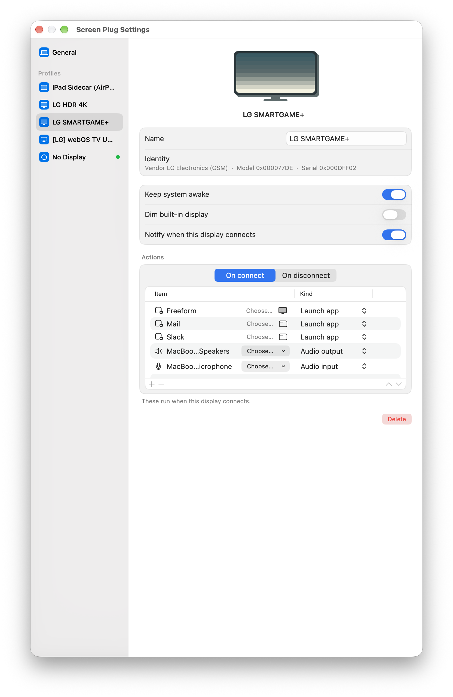
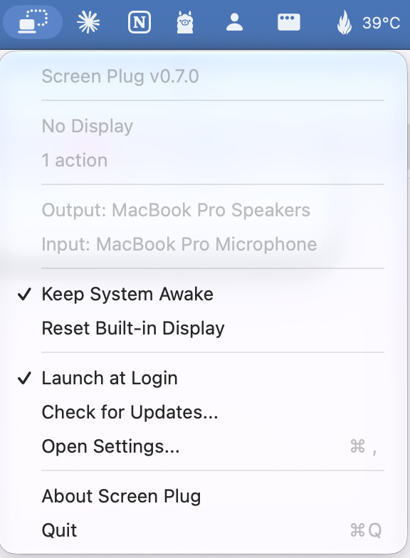
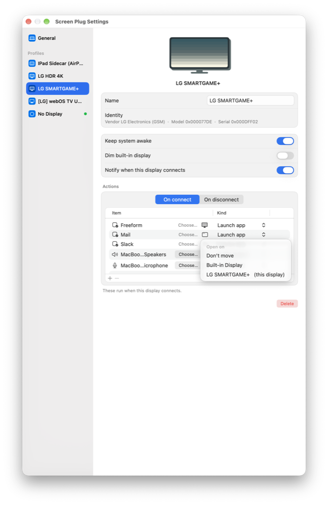
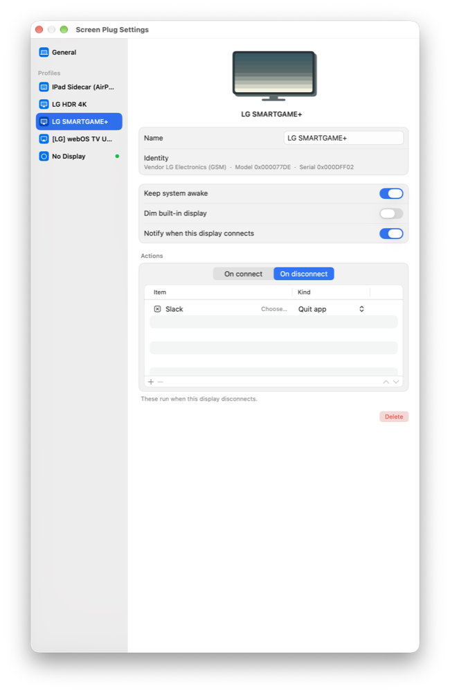
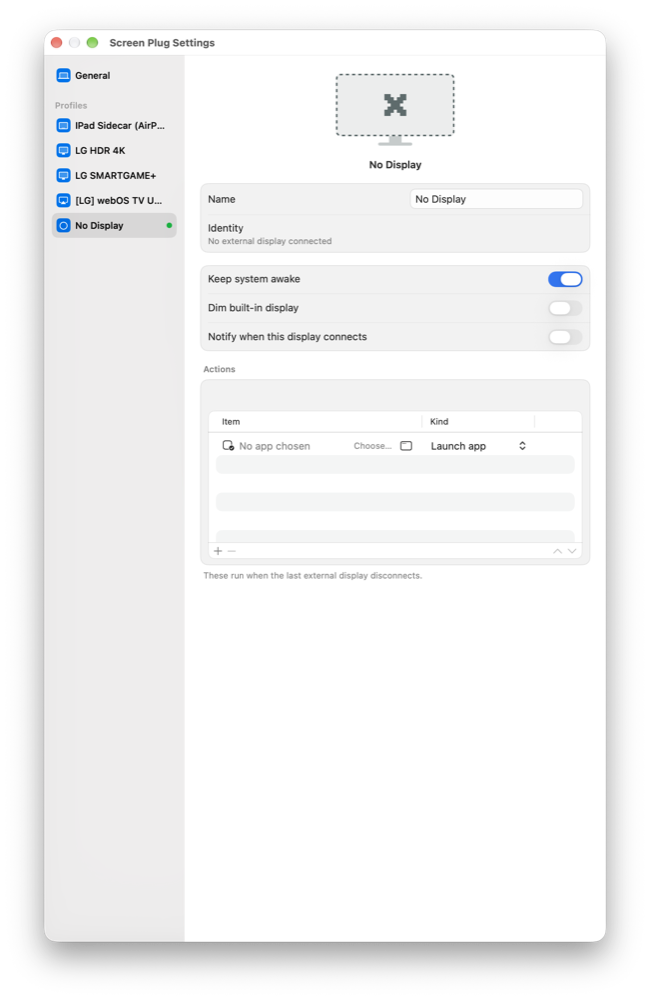
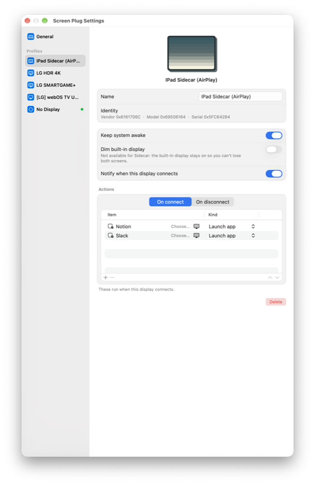
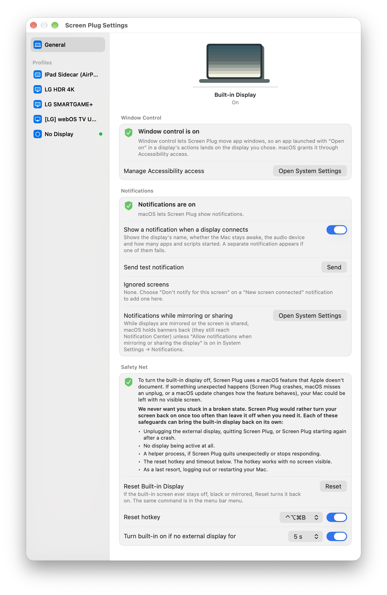

# 🔌 Screen Plug

**Plug in a monitor. Your Mac sets itself up.**

Screen Plug applies the right settings and actions each time a display connects, and puts everything back when you unplug.

 

 

## ✨ One plug, the whole desk

Docking a laptop means the same chores every time. Screen Plug remembers each monitor and does them for you.

| | |
|---|---|
| 🖥️ **Displays: a profile per monitor** | Each display is recognized by its vendor, model and serial number and keeps its own settings. A separate profile covers the times when nothing is plugged in. |
| ⚡ **Actions: do things on connect and disconnect** | Launch or quit apps, run Shortcuts or shell commands, switch audio input and output, and choose which screen an app opens on. |
| 🌙 **Power: stay awake, dim the laptop** | Keep the Mac awake while a display is connected, and turn the built-in screen off while you work on the big one. |
| 🛟 **Safety net: never stuck on a black screen** | Several independent safeguards, including a hotkey that works with no screen visible, bring the built-in display back on its own. |

 

## 🚀 How it works

1. **Plug in a display.** Screen Plug sits in the menu bar and creates a profile the first time it sees a monitor.
2. **Set it up once.** Choose what should happen when it connects and when it disconnects.
3. **Forget about it.** Every time that display appears, your Mac is set up the way you like. Unplug it and it goes back.

 

## 📥 Get it, free

1. Download the latest DMG from [Releases](https://github.com/bytefella/screenplug-releases/releases/latest).
2. Drag **Screen Plug** to Applications and launch it. It lives in the menu bar.
3. Connect a display and open **Settings…** to configure its profile.

Screen Plug is **free to use**: no account, no license key and no trial. Updates install in place after you confirm.

> [!NOTE]
> Releases up to 0.7.0 are not notarized, so macOS Gatekeeper blocks their first launch. To allow it, open **System Settings → Privacy & Security**, scroll to the message about Screen Plug and click **Open Anyway** (or right-click the app and choose **Open**). Version 0.7.1 and later are notarized and open normally.

 

## 👀 A look inside

<table>
<tr>
<td width="300" valign="middle"></td>
<td valign="middle">

### Lives in your menu bar

No Dock icon, no window in your way. The menu shows the active profile and what it does, the current audio devices, and a one-click reset for the built-in display. You can also toggle **Keep System Awake** for the current session, launch at login and check for updates.

</td>
</tr>
</table>

<table>
<tr>
<td align="center" width="50%"> Per-display settings and actions.</td>
<td align="center" width="50%"> Choose which screen an app opens on.</td>
</tr>
<tr>
<td align="center"> Clean up when the display goes away.</td>
<td align="center"> A profile for when nothing is plugged in.</td>
</tr>
<tr>
<td align="center"> iPad Sidecar gets its own profile.</td>
<td align="center"> Window control, notifications and the safety net.</td>
</tr>
</table>

 

## 🖥️ Display profiles

Every display you connect appears in the Settings sidebar, with a green dot on each one that is connected right now. Per profile you can set:

- **Name**: how the display appears in the sidebar, menu and notifications. The icon is chosen from the display type
- **Keep system awake** and **Dim built-in display**
- **Notify when this display connects**
- **Actions** on connect and on disconnect: launch app, quit app (picked from your Applications folder), run Shortcut, run shell command, audio output, audio input
- **Open on**: for launched apps, choose the display the app's window opens on
- **Delete**: the profile is created again the next time the display connects

Actions run for a screen even when another one is the active display.

### 📍 Open apps on a chosen display

Next to each **Launch app** action, the **Open on** menu lets you pick **Don't move**, **Built-in Display** or the display the profile belongs to. Moving windows needs Accessibility access. **Settings → General** shows whether it is on and links to the right System Settings page. Until it is allowed, apps open where they put themselves.

### 📱 Sidecar and AirPlay

An iPad used as Sidecar gets its own profile with the same keep-awake and action options. Dimming the built-in display is deliberately unavailable for Sidecar, so you can't lose both screens. AirPlay displays are treated as a normal external display.

 

## 🔔 Notifications

When a screen connects, Screen Plug tells you what happened: the display name, whether the Mac stays awake, whether the built-in display is dimmed, the audio device, and how many apps and scripts started. If an action fails, a separate notification says which one. In **Settings → General** you can turn notifications on or off, send a test, and bring back screens you chose to ignore with **Notify again**.

 

## 🛟 Safety net

Turning the built-in display off relies on an undocumented macOS feature. Screen Plug would rather turn your screen on once too often than leave it off, so any of these brings it back on its own:

- Unplugging the external display, quitting Screen Plug, or Screen Plug restarting after a crash (dimming is applied again when the display is still connected)
- No display being active at all
- A helper process that acts if Screen Plug exits unexpectedly or stops responding
- The **reset hotkey** (`⌃⌥⌘B` by default), which works with no screen visible
- A **timeout** when no external display is present
- As a last resort, logging out or restarting the Mac

 

## 📦 Requirements

- macOS 14.0 or later

 

---

This repository only hosts release builds. Screen Plug is free to use under its end user license agreement (EULA), but it is proprietary software: you may not redistribute or modify it, and the source code is not published. 
See the [privacy policy](https://screenplug.app/privacy/) and [contact](https://screenplug.app/contact/). 
© 2026 Radomir Sohlich. All rights reserved.

